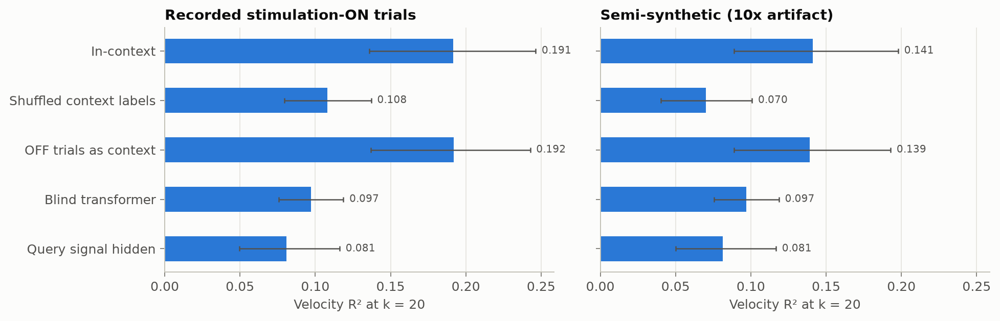
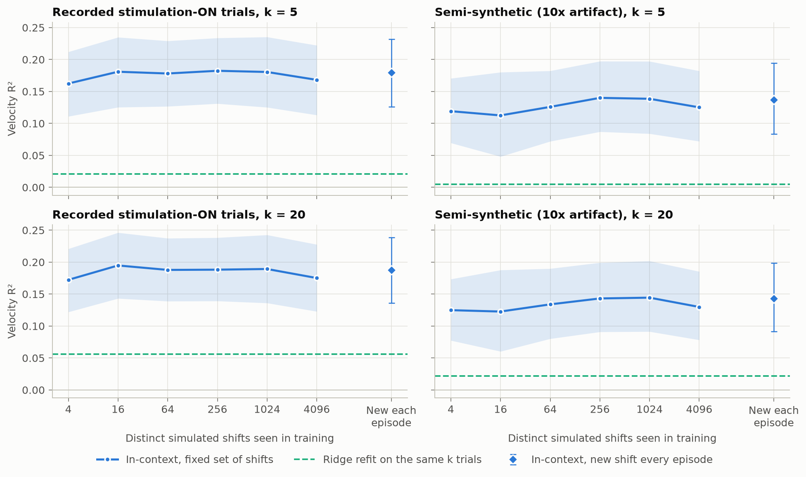

# Task 5 results: in-context recalibration

The plan, success criteria and every change to them are in [DESIGN.md](DESIGN.md). All numbers below are
from the **5 test days (14 stimulation sessions)**, scored once after all choices were frozen on validation
days. Each number averages 5 training seeds. R² is velocity R², averaged over vx and vy.

## 1. Bottom line

1. **Context helps.** With 20 labeled trials, R² rises from 0.093 to 0.191 on recorded trials and from 0.064
   to 0.141 with a 10× artifact. Shuffling the context labels removes 85% and 92% of that gain.
2. **The primary test failed.** At k = 20 the model does not reliably beat a reference that uses movement
   labels but no brain signal: **+0.046 (95% CI −0.006 to 0.096) on recorded trials and −0.004 (−0.059 to
   0.047) with the 10× artifact.**
3. **We found no stimulation-specific recalibration.** Context from the same day's stimulation-OFF session
   works as well as stimulation-ON context, and the OFF-to-ON performance gap does not shrink as k grows.
   A follow-up diagnostic on validation days (Section 6) shows that the model barely uses the brain signal
   in its context, so its gain from context comes from the context movement labels.
4. **The comparison with fine-tuning and LoRA (H2) is still open**, because the Task 4 results do not exist yet.
5. **A redesigned decoder reads the context signal and does better on the test days, as an exploratory result
   (Section 8).** At k = 20 it beats the labels-only average by +0.081 (0.051 to 0.108) on recorded trials and
   +0.042 (0.014 to 0.071) with the 10× artifact. It was designed after the first test read, so it does not
   replace the failed primary test above.
6. **Training it with time jitter helps further, also as an exploratory result (Sections 8.2 and 8.3).** On the test
   days at k = 20, one model reaches R² 0.282 on recorded trials and 0.218 with the 10× artifact: +0.136 (0.097 to
   0.174) and +0.072 (0.031 to 0.118) over labels-only. Averaging 5 seeds' predictions adds about +0.015 to +0.02.
   This was the third read of the test days, so a confirmatory test needs new recordings.

## 2. Test-day R²


| k | Recorded: in-context | Labels-only | Blind transformer | Ridge refit | 10× artifact: in-context | Ridge refit |
|---:|---:|---:|---:|---:|---:|---:|
| 0 | 0.093 | 0.086 | 0.054 | n/a | 0.064 | n/a |
| 2 | 0.170 | 0.099 | 0.083 | 0.002 | 0.122 | −0.005 |
| 5 | 0.184 | 0.113 | 0.091 | 0.021 | 0.136 | 0.005 |
| 10 | 0.186 | 0.127 | 0.096 | 0.039 | 0.137 | 0.015 |
| 20 | 0.191 | 0.146 | 0.097 | 0.056 | 0.141 | 0.022 |

The labels-only and blind references do not read the brain signal, so they are the same for both inputs.

## 3. Pre-specified checks

Intervals are paired 95% bootstrap intervals over the 14 sessions.

| Check | Recorded | 10× artifact | Verdict |
|---|---|---|---|
| H1: k = 20 beats k = 0 | +0.098 (0.054, 0.143) | +0.077 (0.036, 0.122) | **Pass** |
| **Primary: neural gain at k = 20** | +0.046 (−0.006, 0.096) | −0.004 (−0.059, 0.047) | **Fail** |
| H2: against fine-tuning and LoRA | not available | not available | **Not tested** |
| H3: shuffling labels loses at least half the gain | loses 0.084 of 0.098 | loses 0.071 of 0.077 | **Pass** |
| C2: ON context beats OFF context at k = 20 | −0.000 (−0.023, 0.020) | +0.002 (−0.016, 0.018) | **Fail** |
| C3: hiding the query signal lowers R² | +0.111 (0.062, 0.160) | +0.060 (0.004, 0.113) | **Pass** |
| C4: stimulation monitor leaks no movement | leak −0.001 | same recordings | **Pass** |

C3 on the 10× artifact is less secure than the table suggests: its stricter whole-day interval includes 0
(−0.033 to 0.136). The overfit check (5.3.3) and the simulated-versus-real check (5.1.3) also passed.



**Stimulation loss.** The OFF-minus-ON gap grows with context instead of shrinking, from 0.025 at k = 0 to
0.053 at k = 20 on recorded trials, and from 0.055 to 0.104 with the 10× artifact. Context helps OFF sessions
at least as much as ON sessions. The proposal's `fraction_recovered` is above 100% for this reason, so it
should not be quoted as recovery from stimulation.

## 4. Exploratory: the gain depends on stimulation frequency

This analysis was done **after** seeing the test results, so it is a lead and not a finding. Neural gain at
k = 20, against the labels-only average:

| Split | Stimulation | Sessions (days) | Recorded | 10× artifact |
|---|---|---:|---:|---:|
| Test | 20 Hz | 7 (2) | +0.069 (0.001, 0.130) | +0.056 (−0.001, 0.109) |
| Test | 3 Hz | 7 (3) | +0.023 (−0.052, 0.098) | **−0.065 (−0.134, −0.004)** |
| Validation | 20 Hz | 4 (3) | +0.087 (0.019, 0.133) | +0.073 (0.022, 0.100) |
| Validation | 3 Hz | 2 (2) | −0.026 (−0.118, 0.065) | **−0.107 (−0.212, −0.002)** |

The same pattern appears in both splits: the model tends to help at 20 Hz and tends to hurt at 3 Hz under a
strong artifact. A 3 Hz artifact overlaps the low-frequency signal that carries movement information, which
could explain this, but we did not test that. Each day used one frequency, so frequency and day are confounded.

## 5. Task 5.7: how many distinct shifts does training need?

We trained one model (seed 1) on each fixed set of simulated shifts and scored it on the test days at k = 20.
Intervals are 95% bootstrap intervals over the 14 sessions.



| Distinct shifts in training | Recorded | 10× artifact |
|---|---:|---:|
| 4 | 0.172 (0.122, 0.221) | 0.125 (0.077, 0.173) |
| 16 | 0.195 (0.143, 0.246) | 0.123 (0.060, 0.188) |
| 64 | 0.188 (0.139, 0.237) | 0.134 (0.080, 0.190) |
| 256 | 0.188 (0.139, 0.238) | 0.143 (0.091, 0.199) |
| 1,024 | 0.189 (0.136, 0.243) | 0.144 (0.091, 0.202) |
| 4,096 | 0.175 (0.123, 0.228) | 0.130 (0.078, 0.185) |
| New shift every episode | 0.188 (0.136, 0.239) | 0.143 (0.091, 0.198) |
| Ridge refit on the same 20 trials | 0.056 (0.038, 0.076) | 0.022 (−0.001, 0.045) |

**We see no clear dependence on the number of shifts.** The differences between pool sizes are about as large
as the differences between training seeds of the main model (0.180 to 0.202 recorded, 0.126 to 0.155 with the
10× artifact). With one seed per pool size, this sweep cannot resolve a small effect.

Two points limit the reading. Every model beats the ridge refit, but so does the labels-only average (0.146),
so beating ridge is not evidence of neural adaptation. Also, a "distinct shift" fixes the template, gains,
amplitude and frequency, while stimulation phase, trial gain and residual noise are still drawn fresh each
episode, so even the 4-shift model sees some variation.

## 6. Diagnostic: the model ignores the brain signal in its context

This was run after the test days were scored, on **validation days only** (6 stimulation sessions, 5 seeds),
with no new training. The context labels stayed real and only the context's brain signal was changed. With
nothing changed, the diagnostic reproduces the saved scores exactly.

R² at k = 20, with the drop from the real context and its 95% interval over sessions:

| Context signal | Recorded R² | Drop | 10× artifact R² | Drop |
|---|---:|---:|---:|---:|
| Real | 0.162 | | 0.126 | |
| All zeros | 0.159 | 0.0025 (0.0005, 0.0040) | 0.124 | 0.0018 (−0.0000, 0.0033) |
| Paired with another context trial | 0.162 | 0.0000 (−0.0001, 0.0002) | 0.126 | 0.0000 (−0.0001, 0.0002) |
| Same-day OFF signal | 0.161 | 0.0004 (0.0001, 0.0007) | 0.125 | 0.0004 (−0.0002, 0.0008) |

A change counted as mattering only if the drop was at least 0.01 and its interval excluded 0, a rule fixed
before running. **No change met it at any k from 2 to 20**, and the largest drop was 0.0025.

The model therefore uses the context as a template of the movement and decodes from the query's own signal.
It does not learn a session-specific mapping from signal to movement. This explains why shuffling the labels
hurts (H3) while replacing ON context with OFF context does not (C2). The check covers 6 sessions whose days
were also used to select checkpoints.

## 7. Follow-up: channel-mixing training did not fix this

To make the context's brain signal necessary, we retrained with one random channel-mixing matrix per episode,
`M = (1 - a) I + a Q`, where Q is a random orthogonal matrix and `a` is uniform from 0 to `alpha_max`. This
pilot used seed 1 and **validation days only**. The pass rule was fixed before training: at k = 20, zeroing the
context signal must lower R² by at least 0.01 with an interval above 0 for both inputs, on newly mixed data (A)
and on real data (C), and real validation R² must stay within 0.02 of the unmixed model's 0.153 (B).

| `alpha_max` | Real validation R² | R² on mixed data, recorded / 10× | Drop on mixed data, recorded / 10× | Drop on real data, recorded / 10× | Gates A / B / C |
|---:|---:|---:|---:|---:|---|
| 0.25 | 0.142 | 0.170 / 0.117 | 0.0024 / 0.0013 | 0.0021 / 0.0014 | Fail / Pass / Fail |
| 0.5 | 0.151 | 0.131 / 0.091 | 0.0030 / 0.0026 | 0.0029 / 0.0025 | Fail / Pass / Fail |
| 1.0 | 0.127 | −0.012 / 0.008 | 0.0007 / 0.0007 | 0.0002 / 0.0002 | Fail / Fail / Fail |

**No setting passed, so the 5-seed run was not started and the test days were not read.** The largest drop was
0.0030, against a threshold of 0.01. At full mixing the model cannot decode at all (R² near 0), and the context
signal still makes no difference, so it did not learn to work out the mapping from the context.

One possible reason, which we did not test, is the architecture: the encoder applies fixed spatial filters to each
trial before the transformer sees it, so the context cannot change how a query's channels are combined. Another is
that 20 trials at this signal-to-noise level may not identify a 35 × 35 mixing matrix.

## 8. Follow-up: a decoder that calibrates from the context signal

The model and the first table use **validation days only** (3 days, 6 stimulation sessions, 5 seeds). These days
also selected checkpoints and the pilot setting, so those scores are optimistic. Section 8.1 then scores the
frozen model once on the test days.

The new decoder encodes each trial on its own and then computes a session correction in closed form:

```
prediction(t) = template(t) + features(t) * (global_readout + session_correction)
```

The correction is a ridge regression from the context features to what the template and global readout got
wrong on the context trials. No weights are updated at test time. Training uses the same simulated shifts on
real OFF trials. The pilot rule was fixed before training, and the setting without channel mixing was chosen.

R² at k = 20, with paired 95% intervals over sessions:

| Measure | Recorded | 10× artifact |
|---|---:|---:|
| Calibrated decoder | 0.210 | 0.177 |
| First model | 0.162 | 0.126 |
| Labels-only average | 0.112 | 0.112 |
| Calibrated minus first model | +0.048 (−0.011, 0.132) | +0.051 (−0.009, 0.140) |
| Calibrated minus labels-only | +0.098 (0.063, 0.130) | +0.065 (0.032, 0.101) |
| Drop when signal-label pairing is broken | 0.088 (0.044, 0.139) | 0.059 (0.030, 0.111) |
| Own ON context minus same-day OFF context | +0.089 (0.045, 0.137) | +0.098 (0.057, 0.142) |
| Own ON context minus the day's other ON session | +0.028 (−0.028, 0.075) | +0.038 (−0.019, 0.086) |
| The day's other ON session minus OFF context | +0.061 (0.008, 0.131) | +0.060 (−0.000, 0.134) |

- **The model now reads the context signal.** Breaking the pairing lowers R² on all 6 sessions for both inputs.
- **It is not yet reliably better than the first model.** Both intervals for that difference include 0.
- **ON context beats OFF context on all 6 sessions for both inputs.** The first model's difference was +0.017
  recorded and +0.026 with the 10× artifact.
- **We cannot yet call this stimulation-specific.** ON context comes from the query's own session and OFF context
  does not. Context from the day's other ON session is a partial control, and it beats OFF clearly only on
  recorded trials. OFF was recorded first each day, so this difference can also reflect time between sessions.
- **One day contributes the most.** On 2025-05-23, OFF context gives R² near 0. Without that day, own ON minus
  OFF is still +0.053 recorded and +0.063 with the 10× artifact.
- **Wrong-session context can hurt.** With OFF context and the 10× artifact, R² is 0.079, below labels-only.

### 8.1 Exploratory test-day result

This decoder was designed after the first model's test results were seen, so this result is **exploratory** and
does not replace Section 3. Before the test days were read, the code, chosen setting and 5 checkpoints were hashed
(`task5_results/frozen_calibrated_before_test.sha256`), the comparisons were fixed, and the scoring script
reproduced every saved validation number. The intervals are not corrected for multiple comparisons.

Test-day R² (5 days, 14 stimulation sessions, 5 seeds). All methods here use the first 3 context draws, so values
at k < 20 differ slightly from Section 2, which uses 10 draws:

| k | Recorded: calibrated | Recorded: first model | 10×: calibrated | 10×: first model | Labels-only |
|---:|---:|---:|---:|---:|---:|
| 2 | 0.129 | 0.166 | 0.090 | 0.117 | 0.096 |
| 5 | 0.172 | 0.188 | 0.134 | 0.137 | 0.113 |
| 10 | 0.200 | 0.191 | 0.159 | 0.140 | 0.127 |
| 20 | 0.227 | 0.191 | 0.187 | 0.141 | 0.146 |

Paired differences at k = 20, with 95% intervals over sessions:

| Comparison | Recorded | 10× artifact |
|---|---:|---:|
| Calibrated minus labels-only | +0.081 (0.051, 0.108) | +0.042 (0.014, 0.071) |
| Calibrated minus first model | +0.035 (0.003, 0.072) | +0.046 (0.012, 0.088) |
| Drop when signal-label pairing is broken | 0.084 (0.052, 0.118) | 0.055 (0.029, 0.080) |
| Own ON context minus same-day OFF context | +0.085 (0.049, 0.123) | +0.069 (0.034, 0.109) |
| Own ON context minus other ON sessions (13 sessions) | +0.021 (0.004, 0.037) | +0.014 (−0.002, 0.030) |
| Other ON sessions minus OFF context (13 sessions) | +0.058 (0.020, 0.101) | +0.046 (0.018, 0.079) |

- **The gain over labels-only holds at k = 20.** Its stricter whole-day intervals are also above 0: 0.037 to 0.114
  recorded and 0.005 to 0.089 with the 10× artifact.
- **The new decoder needs enough context.** It is worse than the first model at k = 2 (−0.038 recorded, −0.026
  with the 10× artifact) and is ahead only from k = 10. Its k = 20 advantage on recorded trials has a whole-day
  interval that includes 0 (−0.007 to 0.096).
- **Most of the ON advantage survives a change of session.** Context from another ON session still beats OFF
  context on both inputs. This fits a stimulation-state effect, but OFF was always recorded first, so the time
  between sessions could also explain it.
- **The frequency pattern does not replicate.** The other-ON advantage over OFF is larger at 3 Hz on test days
  (+0.109 recorded, +0.079 with the 10× artifact, against +0.013 and +0.019 at 20 Hz), but larger at 20 Hz on
  validation days. Frequency is confounded with day, so we draw no conclusion about it.
- **These test days are no longer clean for this model.** Any further change needs new data for a confirmatory test.

### 8.2 Follow-up on validation: overfitting, timing and seed averaging

Validation days only. The test days were not read. The calibrated decoder overfits: its validation score peaks
early (step 1500) while the training loss keeps falling. We tried three changes in a fixed order, with the rule
written in `task5_improve.py` before training. A change is adopted only if (1) seed 1's validation score rises by at
least 0.01, and (2) at k = 20, breaking the signal-label pairing still lowers R² by at least 0.01 with an interval
above 0, for both inputs. The score is the mean validation R² over both inputs at k = 2, 5, 10 and 20.

**Step 1: less overfitting.** Jitter shifts each training trial's signal and labels together by up to ±2 bins
(±100 ms); bins moved in are not scored. "Small" halves the width (d_model 64, 2 layers). "Dropout" raises dropout to
0.3, and to 0.5 in the encoder.

| Setting | Seed-1 score | Gain |
|---|---:|---:|
| Calibrated decoder (current) | 0.158 | |
| Small | 0.181 | +0.023 |
| Dropout | 0.165 | +0.008 |
| **Jitter (adopted)** | **0.189** | **+0.031** |
| Small + dropout | 0.159 | +0.001 |
| Small + jitter | 0.186 | +0.028 |
| Dropout + jitter | 0.185 | +0.027 |
| Small + dropout + jitter | 0.159 | +0.002 |

**Step 2: predict each trial's timing.** The model also predicted a per-trial time shift of the movement template
(up to ±0.5 s), or a shift and a gain. Both lowered the score (0.178 and 0.179, −0.010), so neither was adopted. Each
query trial's true timing would help a lot: the shifted template alone reaches R² 0.36 on recorded trials, as an
upper bound that uses the query's own velocity. The model did not learn to predict that timing well enough to help.

**Step 3: 5 seeds of the jitter decoder.** R² on the first 3 context draws:

| Method | Recorded, k = 2 | Recorded, k = 20 | 10×, k = 2 | 10×, k = 20 |
|---|---:|---:|---:|---:|
| Jitter decoder, average of 5 seeds' predictions | 0.189 | 0.256 | 0.146 | 0.210 |
| Jitter decoder, one model (mean over seeds) | 0.169 | 0.241 | 0.127 | 0.196 |
| Calibrated decoder, average of 5 seeds' predictions | 0.158 | 0.227 | 0.131 | 0.192 |
| Calibrated decoder, one model | 0.132 | 0.210 | 0.106 | 0.177 |
| First model (mean over seeds) | 0.145 | 0.162 | 0.114 | 0.126 |
| Labels-only average | 0.058 | 0.112 | 0.058 | 0.112 |

Paired differences at k = 20, with 95% intervals over sessions:

| Comparison | Recorded | 10× artifact |
|---|---:|---:|
| Jitter, one model minus calibrated, one model | +0.031 (0.009, 0.054) | +0.019 (0.002, 0.038) |
| Jitter, 5-seed average minus one model | +0.016 (0.012, 0.019) | +0.014 (0.009, 0.020) |
| Jitter, 5-seed average minus first model | +0.095 (0.041, 0.163) | +0.084 (0.028, 0.162) |
| Jitter, 5-seed average minus labels-only | +0.144 (0.088, 0.197) | +0.098 (0.052, 0.153) |
| Drop when signal-label pairing is broken (one model) | 0.097 (0.053, 0.153) | 0.065 (0.033, 0.118) |

- **Jitter is the only change adopted, and its gain is not a seed-1 accident.** On seeds 2 to 5, which played no part
  in the choice, the mean validation score is 0.182 against 0.155 for the calibrated decoder.
- **Averaging 5 seeds adds about +0.015 at every k**, on both inputs.
- **The jitter decoder no longer needs much context to beat the first model.** At k = 2, one jitter model scores
  0.169 against 0.145 for the first model, where one calibrated model scored 0.132. Compare one model with the first
  model, because the first model's numbers average R² over seeds, not predictions.
- **It still reads the context signal.** Breaking the pairing lowers R² on all 6 sessions for both inputs at k = 20.
- **These numbers are optimistic.** The same 6 sessions chose the setting and the checkpoints. The test days have
  already been read once for the calibrated decoder, so any test score for this decoder is exploratory too.

### 8.3 Exploratory test-day result for the jitter decoder

This is the third read of the test days (first model, calibrated decoder, now this), so it is **exploratory**. Before
the read, the code, the choice file and the 5 checkpoints were hashed (`task5_results/frozen_improve_before_test.sha256`),
the comparisons were fixed in `task5_improve_test.py`, and the script reproduced every saved Section 8.2 validation
number. On the test days it also reproduced the calibrated decoder's Section 8.1 scores exactly.

Test-day R² (5 days, 14 stimulation sessions, first 3 context draws). "One model" averages R² over the 5 seeds, like
the first model's numbers. "5-seed average" scores the mean of the 5 seeds' predictions:

| k | Recorded: jitter, one model | Recorded: jitter, 5-seed average | Recorded: calibrated | Recorded: first model | 10×: jitter, one model | 10×: jitter, 5-seed average | 10×: calibrated | 10×: first model | Labels-only |
|---:|---:|---:|---:|---:|---:|---:|---:|---:|---:|
| 2 | 0.183 | 0.206 | 0.129 | 0.166 | 0.121 | 0.141 | 0.090 | 0.117 | 0.096 |
| 5 | 0.229 | 0.253 | 0.172 | 0.188 | 0.167 | 0.187 | 0.134 | 0.137 | 0.113 |
| 10 | 0.257 | 0.279 | 0.200 | 0.191 | 0.192 | 0.210 | 0.159 | 0.140 | 0.127 |
| 20 | 0.282 | 0.300 | 0.227 | 0.191 | 0.218 | 0.233 | 0.187 | 0.141 | 0.146 |

Paired differences at k = 20, one jitter model unless stated, with 95% intervals over sessions and over whole days:

| Comparison | Recorded | Recorded, day interval | 10× artifact | 10×, day interval |
|---|---:|---:|---:|---:|
| Jitter minus labels-only | +0.136 (0.097, 0.174) | (0.075, 0.183) | +0.072 (0.031, 0.118) | (0.012, 0.146) |
| Jitter minus calibrated | +0.055 (0.039, 0.073) | (0.034, 0.071) | +0.031 (0.011, 0.053) | (0.004, 0.059) |
| Jitter minus first model | +0.090 (0.061, 0.123) | (0.047, 0.150) | +0.077 (0.043, 0.111) | (0.038, 0.127) |
| 5-seed average minus one model | +0.018 (0.017, 0.020) | (0.017, 0.020) | +0.015 (0.012, 0.018) | (0.011, 0.018) |
| Drop when signal-label pairing is broken | 0.121 (0.086, 0.159) | (0.081, 0.147) | 0.079 (0.046, 0.110) | (0.037, 0.115) |
| Own ON context minus same-day OFF context | +0.093 (0.056, 0.128) | (0.047, 0.146) | +0.066 (0.036, 0.094) | (0.032, 0.102) |
| Own ON context minus other ON sessions (13 sessions) | +0.023 (0.009, 0.037) | (0.013, 0.030) | +0.016 (−0.005, 0.035) | (−0.002, 0.028) |
| Other ON sessions minus OFF context (13 sessions) | +0.067 (0.027, 0.108) | (0.014, 0.128) | +0.042 (0.018, 0.067) | (0.006, 0.074) |

- **The validation gain carries over to the test days.** One jitter model beats the calibrated decoder at every k on
  both inputs, by +0.055 to +0.058 on recorded trials and +0.030 to +0.033 with the 10× artifact.
- **The k = 2 deficit is gone, but there is no clear win at k = 2.** At k = 2, jitter minus the first model is +0.017
  (−0.024, 0.058) on recorded trials and +0.004 (−0.030, 0.036) with the 10× artifact. From k = 10 on, it is ahead
  on both inputs with session intervals above 0.
- **With the 10× artifact, it needs some context.** At k = 2 it is +0.025 (−0.023, 0.077) over labels-only, an
  interval that includes 0. At k = 20 the gain is +0.072, and the whole-day interval is above 0.
- **The 10× gain comes mostly from the 20 Hz sessions.** At k = 20 with the 10× artifact, jitter minus labels-only is
  +0.020 (−0.000, 0.038) at 3 Hz and +0.125 (0.057, 0.191) at 20 Hz. Frequency is confounded with day, so this only
  describes the data.
- **It reads the context signal more than the calibrated decoder did.** Breaking the pairing costs 0.121 on recorded
  trials (0.084 for the calibrated decoder) and 0.079 with the 10× artifact (0.055).
- **The ON-versus-OFF picture is unchanged.** Own ON context beats OFF, and most of that advantage survives a change to
  another ON session. OFF was always recorded first, so the time between sessions could also explain it.

## 9. Limitations

- **One animal, few days.** All sessions come from Butters. There are 5 test days, and sessions from one day
  are correlated. With whole-day resampling, none of the neural-gain intervals at any k > 0 excludes 0.
- **k = 0 is not fully uncalibrated.** Normalization uses the session's 20 unlabeled calibration trials at every k.
- **k = 0 reference.** The frozen choice at k = 0 was the blind transformer, but on test days the labels-only
  average was stronger. Against labels-only, k = 0 gain is +0.008 (−0.012, 0.027) recorded and −0.022
  (−0.047, −0.002) with the 10× artifact. The `PRIMARY ... k=0` rows in `checks_test.csv` overstate it.
- **Session order.** OFF sessions were always recorded first on test days, so OFF-ON differences may include drift.
- **Draws.** k = 20 uses the full pool, so it has one draw. Controls use the first 3 of the 10 draws.
- **Validation scores are optimistic**, because checkpoints were selected on those days. Use the test numbers.

## 10. Reproduce

Run from the repository root, using one GPU. Each step skips or overwrites only its own outputs.

```bash
export CUDA_VISIBLE_DEVICES=1
python task5/test_task5.py                                 # unit tests
python task5/task5_train.py --overfit                      # 5.3.3
python task5/task5_check_simulation.py                     # 5.1.3
python task5/task5_sweep.py                                # 5.4.1
python task5/task5_run_final.py                            # 5.4.2: 5 in-context + 5 blind seeds

for split in val test; do                                  # run val first: it freezes the choices
  python task5/task5_reference_ridge.py --split $split
  python task5/task5_control_monitor.py --split $split
  python task5/task5_score.py --split $split
  python task5/task5_analyze.py --split $split
done

python task5/task5_explore.py                              # exploratory frequency breakdown
python task5/task5_diagnose_context.py                     # context-signal diagnostic (validation only)
python task5/task5_mixing.py --pilot                       # channel-mixing follow-up (validation only)
python task5/test_task5_calibrated.py                      # calibrated decoder unit tests
python task5/task5_calibrated.py --pilot --final --compare # calibrated decoder (validation only)
python task5/task5_calibrated_on_off.py                    # ON versus OFF context (validation only)
python task5/task5_calibrated_session_control.py           # own, other ON and OFF context (validation only)
python task5/task5_calibrated_test.py --split val          # must reproduce the saved validation scores
python task5/task5_calibrated_test.py --split test         # exploratory; refuses to run if results exist
python task5/test_task5_improve.py                         # improved decoder unit tests
python task5/task5_improve.py --step1 --step2 --step3      # Section 8.2 (validation only)
python task5/task5_improve_test.py --split val             # must reproduce the Section 8.2 numbers
python task5/task5_improve_test.py --split test            # Section 8.3, exploratory; refuses to run if results exist
python task5/task5_export_predictions.py --split val       # per-trial predictions of the first model
python task5/task5_export_predictions.py --split test
python task5/task5_diversity.py --train                    # 5.7
python task5/task5_diversity.py --score val --analyze val
python task5/task5_diversity.py --score test --analyze test
```

Result tables and figures are in `task5_results/`. All checkpoints are in `data/task5_runs/` and the first model's
per-trial predictions are in `data/task5_predictions/`; both are committed, each with a README. The trial cache
(`data/task5_cache/`, 1.9 GB) is not committed; `python task5/task5_data.py` rebuilds it from the shared data. `task5_results/frozen_before_test.sha256` records the code, settings and checkpoints used for the test run.
