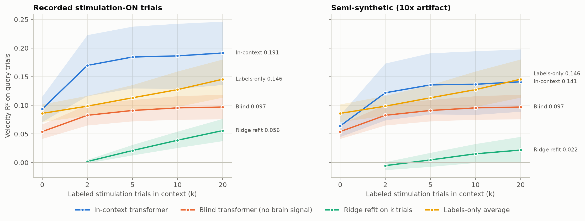

# Task 5 results: in-context recalibration

The plan, success criteria and every change to them are in [DESIGN.md](DESIGN.md). All numbers below are
from the **5 test days (14 stimulation sessions)**, scored once after all choices were frozen on validation
days. Each number averages 5 training seeds. R² is velocity R², averaged over vx and vy.

## 1. Bottom line

1. **Context helps.** With 20 labeled trials, R² rises from 0.093 to 0.191 on recorded trials and from 0.064
   to 0.141 with a 10× artifact. Shuffling the context labels removes 85% and 92% of that gain.
2. **The primary test failed.** At k = 20 the model does not reliably beat a reference that uses movement
   labels but no brain signal: **+0.046 (95% CI −0.006 to 0.096) on recorded trials and −0.004 (−0.059 to
   0.047) with the 10× artifact.**
3. **We found no stimulation-specific recalibration.** Context from the same day's stimulation-OFF session
   works as well as stimulation-ON context, and the OFF-to-ON performance gap does not shrink as k grows.
   A follow-up diagnostic on validation days (Section 6) shows that the model barely uses the brain signal
   in its context, so its gain from context comes from the context movement labels.
4. **The comparison with fine-tuning and LoRA (H2) is still open**, because the Task 4 results do not exist yet.

## 2. Test-day R²



| k | Recorded: in-context | Labels-only | Blind transformer | Ridge refit | 10× artifact: in-context | Ridge refit |
|---:|---:|---:|---:|---:|---:|---:|
| 0 | 0.093 | 0.086 | 0.054 | n/a | 0.064 | n/a |
| 2 | 0.170 | 0.099 | 0.083 | 0.002 | 0.122 | −0.005 |
| 5 | 0.184 | 0.113 | 0.091 | 0.021 | 0.136 | 0.005 |
| 10 | 0.186 | 0.127 | 0.096 | 0.039 | 0.137 | 0.015 |
| 20 | 0.191 | 0.146 | 0.097 | 0.056 | 0.141 | 0.022 |

The labels-only and blind references do not read the brain signal, so they are the same for both inputs.

## 3. Pre-specified checks

Intervals are paired 95% bootstrap intervals over the 14 sessions.

| Check | Recorded | 10× artifact | Verdict |
|---|---|---|---|
| H1: k = 20 beats k = 0 | +0.098 (0.054, 0.143) | +0.077 (0.036, 0.122) | **Pass** |
| **Primary: neural gain at k = 20** | +0.046 (−0.006, 0.096) | −0.004 (−0.059, 0.047) | **Fail** |
| H2: against fine-tuning and LoRA | not available | not available | **Not tested** |
| H3: shuffling labels loses at least half the gain | loses 0.084 of 0.098 | loses 0.071 of 0.077 | **Pass** |
| C2: ON context beats OFF context at k = 20 | −0.000 (−0.023, 0.020) | +0.002 (−0.016, 0.018) | **Fail** |
| C3: hiding the query signal lowers R² | +0.111 (0.062, 0.160) | +0.060 (0.004, 0.113) | **Pass** |
| C4: stimulation monitor leaks no movement | leak −0.001 | same recordings | **Pass** |

C3 on the 10× artifact is less secure than the table suggests: its stricter whole-day interval includes 0
(−0.033 to 0.136). The overfit check (5.3.3) and the simulated-versus-real check (5.1.3) also passed.


**Stimulation loss.** The OFF-minus-ON gap grows with context instead of shrinking, from 0.025 at k = 0 to
0.053 at k = 20 on recorded trials, and from 0.055 to 0.104 with the 10× artifact. Context helps OFF sessions
at least as much as ON sessions. The proposal's `fraction_recovered` is above 100% for this reason, so it
should not be quoted as recovery from stimulation.

## 4. Exploratory: the gain depends on stimulation frequency

This analysis was done **after** seeing the test results, so it is a lead and not a finding. Neural gain at
k = 20, against the labels-only average:

| Split | Stimulation | Sessions (days) | Recorded | 10× artifact |
|---|---|---:|---:|---:|
| Test | 20 Hz | 7 (2) | +0.069 (0.001, 0.130) | +0.056 (−0.001, 0.109) |
| Test | 3 Hz | 7 (3) | +0.023 (−0.052, 0.098) | **−0.065 (−0.134, −0.004)** |
| Validation | 20 Hz | 4 (3) | +0.087 (0.019, 0.133) | +0.073 (0.022, 0.100) |
| Validation | 3 Hz | 2 (2) | −0.026 (−0.118, 0.065) | **−0.107 (−0.212, −0.002)** |

The same pattern appears in both splits: the model tends to help at 20 Hz and tends to hurt at 3 Hz under a
strong artifact. A 3 Hz artifact overlaps the low-frequency signal that carries movement information, which
could explain this, but we did not test that. Each day used one frequency, so frequency and day are confounded.

## 5. Task 5.7: how many distinct shifts does training need?

We trained one model (seed 1) on each fixed set of simulated shifts and scored it on the test days at k = 20.
Intervals are 95% bootstrap intervals over the 14 sessions.


| Distinct shifts in training | Recorded | 10× artifact |
|---|---:|---:|
| 4 | 0.172 (0.122, 0.221) | 0.125 (0.077, 0.173) |
| 16 | 0.195 (0.143, 0.246) | 0.123 (0.060, 0.188) |
| 64 | 0.188 (0.139, 0.237) | 0.134 (0.080, 0.190) |
| 256 | 0.188 (0.139, 0.238) | 0.143 (0.091, 0.199) |
| 1,024 | 0.189 (0.136, 0.243) | 0.144 (0.091, 0.202) |
| 4,096 | 0.175 (0.123, 0.228) | 0.130 (0.078, 0.185) |
| New shift every episode | 0.188 (0.136, 0.239) | 0.143 (0.091, 0.198) |
| Ridge refit on the same 20 trials | 0.056 (0.038, 0.076) | 0.022 (−0.001, 0.045) |

**We see no clear dependence on the number of shifts.** The differences between pool sizes are about as large
as the differences between training seeds of the main model (0.180 to 0.202 recorded, 0.126 to 0.155 with the
10× artifact). With one seed per pool size, this sweep cannot resolve a small effect.

Two points limit the reading. Every model beats the ridge refit, but so does the labels-only average (0.146),
so beating ridge is not evidence of neural adaptation. Also, a "distinct shift" fixes the template, gains,
amplitude and frequency, while stimulation phase, trial gain and residual noise are still drawn fresh each
episode, so even the 4-shift model sees some variation.

## 6. Diagnostic: the model ignores the brain signal in its context

This was run after the test days were scored, on **validation days only** (6 stimulation sessions, 5 seeds),
with no new training. The context labels stayed real and only the context's brain signal was changed. With
nothing changed, the diagnostic reproduces the saved scores exactly.

R² at k = 20, with the drop from the real context and its 95% interval over sessions:

| Context signal | Recorded R² | Drop | 10× artifact R² | Drop |
|---|---:|---:|---:|---:|
| Real | 0.162 | | 0.126 | |
| All zeros | 0.159 | 0.0025 (0.0005, 0.0040) | 0.124 | 0.0018 (−0.0000, 0.0033) |
| Paired with another context trial | 0.162 | 0.0000 (−0.0001, 0.0002) | 0.126 | 0.0000 (−0.0001, 0.0002) |
| Same-day OFF signal | 0.161 | 0.0004 (0.0001, 0.0007) | 0.125 | 0.0004 (−0.0002, 0.0008) |

A change counted as mattering only if the drop was at least 0.01 and its interval excluded 0, a rule fixed
before running. **No change met it at any k from 2 to 20**, and the largest drop was 0.0025.

The model therefore uses the context as a template of the movement and decodes from the query's own signal.
It does not learn a session-specific mapping from signal to movement. This explains why shuffling the labels
hurts (H3) while replacing ON context with OFF context does not (C2). The check covers 6 sessions whose days
were also used to select checkpoints.

## 7. Follow-up: channel-mixing training did not fix this

To make the context's brain signal necessary, we retrained with one random channel-mixing matrix per episode,
`M = (1 - a) I + a Q`, where Q is a random orthogonal matrix and `a` is uniform from 0 to `alpha_max`. This
pilot used seed 1 and **validation days only**. The pass rule was fixed before training: at k = 20, zeroing the
context signal must lower R² by at least 0.01 with an interval above 0 for both inputs, on newly mixed data (A)
and on real data (C), and real validation R² must stay within 0.02 of the unmixed model's 0.153 (B).

| `alpha_max` | Real validation R² | R² on mixed data, recorded / 10× | Drop on mixed data, recorded / 10× | Drop on real data, recorded / 10× | Gates A / B / C |
|---:|---:|---:|---:|---:|---|
| 0.25 | 0.142 | 0.170 / 0.117 | 0.0024 / 0.0013 | 0.0021 / 0.0014 | Fail / Pass / Fail |
| 0.5 | 0.151 | 0.131 / 0.091 | 0.0030 / 0.0026 | 0.0029 / 0.0025 | Fail / Pass / Fail |
| 1.0 | 0.127 | −0.012 / 0.008 | 0.0007 / 0.0007 | 0.0002 / 0.0002 | Fail / Fail / Fail |

**No setting passed, so the 5-seed run was not started and the test days were not read.** The largest drop was
0.0030, against a threshold of 0.01. At full mixing the model cannot decode at all (R² near 0), and the context
signal still makes no difference, so it did not learn to work out the mapping from the context.

One possible reason, which we did not test, is the architecture: the encoder applies fixed spatial filters to each
trial before the transformer sees it, so the context cannot change how a query's channels are combined. Another is
that 20 trials at this signal-to-noise level may not identify a 35 × 35 mixing matrix.

## 8. Limitations

- **One animal, few days.** All sessions come from Butters. There are 5 test days, and sessions from one day
  are correlated. With whole-day resampling, none of the neural-gain intervals at any k > 0 excludes 0.
- **k = 0 is not fully uncalibrated.** Normalization uses the session's 20 unlabeled calibration trials at every k.
- **k = 0 reference.** The frozen choice at k = 0 was the blind transformer, but on test days the labels-only
  average was stronger. Against labels-only, k = 0 gain is +0.008 (−0.012, 0.027) recorded and −0.022
  (−0.047, −0.002) with the 10× artifact. The `PRIMARY ... k=0` rows in `checks_test.csv` overstate it.
- **Session order.** OFF sessions were always recorded first on test days, so OFF-ON differences may include drift.
- **Draws.** k = 20 uses the full pool, so it has one draw. Controls use the first 3 of the 10 draws.
- **Validation scores are optimistic**, because checkpoints were selected on those days. Use the test numbers.

## 9. Reproduce

Run from the repository root, using one GPU. Each step skips or overwrites only its own outputs.

```bash
export CUDA_VISIBLE_DEVICES=1
python task5/test_task5.py                                 # unit tests
python task5/task5_train.py --overfit                      # 5.3.3
python task5/task5_check_simulation.py                     # 5.1.3
python task5/task5_sweep.py                                # 5.4.1
python task5/task5_run_final.py                            # 5.4.2: 5 in-context + 5 blind seeds

for split in val test; do                                  # run val first: it freezes the choices
  python task5/task5_reference_ridge.py --split $split
  python task5/task5_control_monitor.py --split $split
  python task5/task5_score.py --split $split
  python task5/task5_analyze.py --split $split
done

python task5/task5_explore.py                              # exploratory frequency breakdown
python task5/task5_diagnose_context.py                     # context-signal diagnostic (validation only)
python task5/task5_mixing.py --pilot                       # channel-mixing follow-up (validation only)
python task5/task5_diversity.py --train                    # 5.7
python task5/task5_diversity.py --score val --analyze val
python task5/task5_diversity.py --score test --analyze test
```

Result tables and figures are in `task5_results/`. Checkpoints are in `data/task5_runs/` and are not tracked by
git. `task5_results/frozen_before_test.sha256` records the code, settings and checkpoints used for the test run.
